  

  
  
  
  
  
  
  
  

  

### About

I build FiveM servers from the ground up: the core framework, every gameplay module, the in-game interface and the infrastructure behind it.

- **Server decides everything.** Clients only ask; every network call is typed, rate limited and checked on the server.
- **Built for full servers.** Designed for 1000 player slots on OneSync, with spatial grids, state bags and per-tick budgets.
- **One interface.** A single Svelte NUI for the whole server, responsive from 1280×720 up to 4K and ultrawide.
- **Data that holds up.** PostgreSQL with numbered migrations, atomic money writes and an append-only ledger.

### Toolbox

| Area | Tools |
| --- | --- |
| Gameplay | Lua 5.4, CitizenFX natives, OneSync, state bags, routing buckets |
| Interface | Svelte 5, Vite, CSS built for the FiveM browser |
| Data | PostgreSQL, write-behind caching, migrations |
| Ops | Linux, nginx, Cloudflare, tmux, custom anti-dump gateway |
| Quality | StyLua, selene, LuaLS, `resmon` and profiler budgets |

Romania · FiveM · always building

